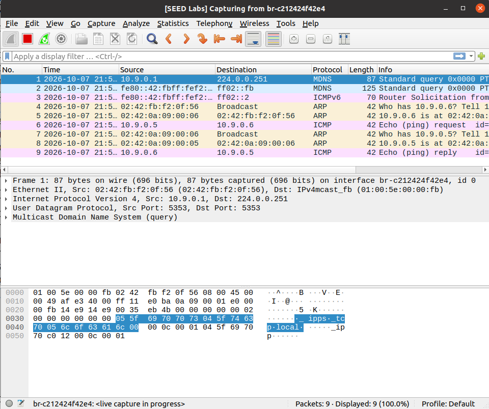

# Network Security Lab Portfolio — COMP 4580 Computer Security

This individual coursework case study covers two controlled SEED-lab exercises:

1. packet sniffing, BPF filtering, ICMP spoofing, and traceroute behavior; and
2. DNS response spoofing, resolver cache poisoning, and forged name-server records.

The activities were performed only inside the supplied virtual-machine and Docker lab environment.

## Tools and concepts

- Wireshark and PCAP analysis
- Python and Scapy packet crafting
- BPF capture filters
- ICMP and TCP traffic inspection
- DNS trust, spoofing, and cache poisoning
- Docker-based isolated lab networking

## Verification status

The recovered Assignment 1 report and screenshots document the completed sniffing/spoofing tasks. The recovered seven-page Assignment 2 report documents the DNS exercises.

The original SEED VM/Docker Compose lab files are not present in the public export, so the labs were **not freshly reproduced** during the hosting pass. This repository is therefore a documentation case study, not a runnable attack toolkit or live demo.

## Publication and privacy boundary

- Only individual Assignments 1 and 2 are represented.
- The group-owned Assignment 3 is excluded.
- Student identifiers and the original reports are not published.
- No exploit service, target system, or public attack instructions are hosted.

## Demo availability

None. These controlled security exercises require the original isolated SEED lab environment.

## Portfolio

[View the case study in my portfolio](https://damilola-durodola.vercel.app/#network-security-lab-portfolio)
